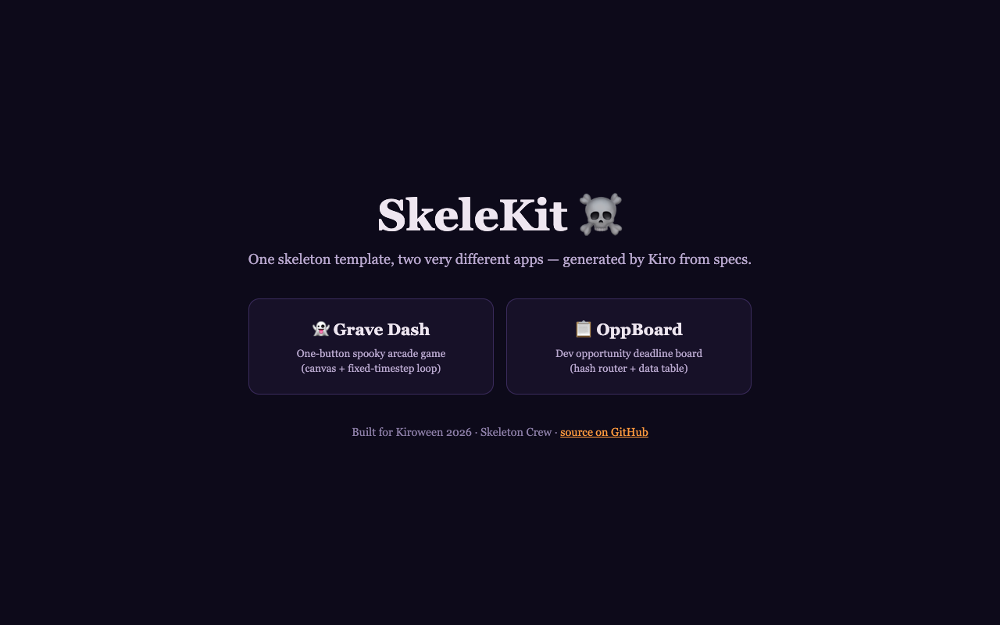
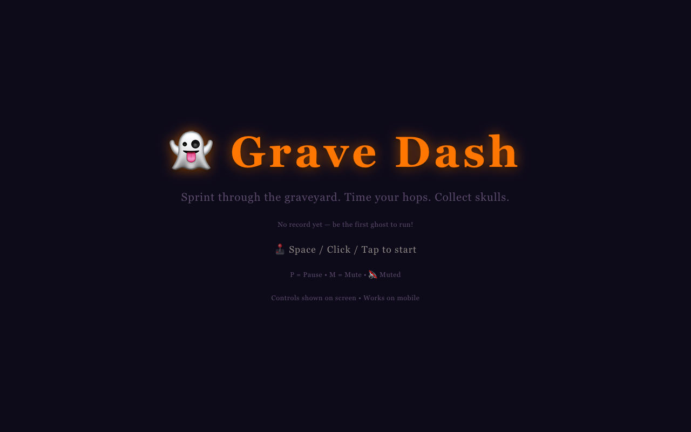
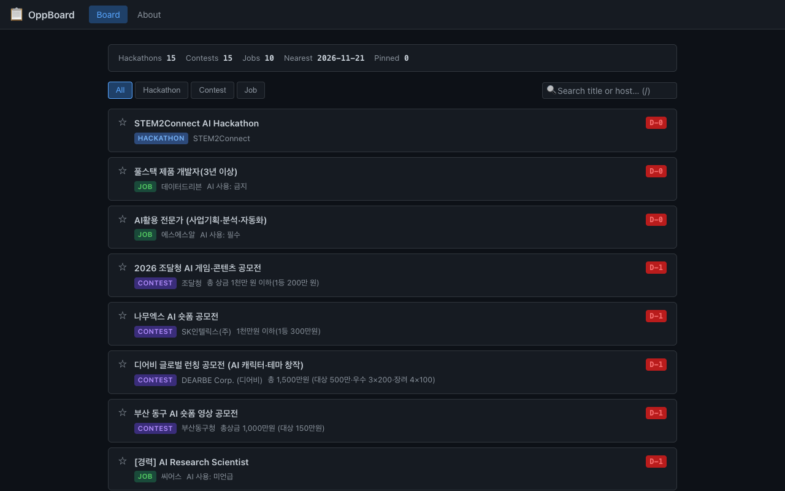

# SkeleKit

**One skeleton, very different apps.** SkeleKit is a spec-driven skeleton template for
shipping deployable web apps with [Kiro](https://kiro.dev) — built for the
**Kiroween 2026** hackathon, *Skeleton Crew* category.

| Path | What it is |
|---|---|
| [`template/`](template/) | The skeleton: Vite + vanilla TypeScript, zero runtime deps |
| [`apps/grave-dash/`](apps/grave-dash/) | App 1 — spooky one-button arcade game (canvas + fixed-timestep loop) |
| [`apps/oppboard/`](apps/oppboard/) | App 2 — opportunity deadline board (hash router + data table) |
| [`.kiro/`](.kiro/) | Steering docs + specs: the source of truth every app is generated from |

## The idea

A skeleton should be *lean enough to be clear* yet *flexible enough to spawn very different
apps*. If a game engine and a productivity board can both grow from the same bones, the
skeleton works. Every app in this repo was generated by Kiro agents executing the spec packs
under `.kiro/specs/` — never hand-copied code.

## Quick start

```bash
# the skeleton itself
cd template && npm install && npm test && npm run dev

# either app
cd apps/grave-dash && npm install && npm run dev
cd apps/oppboard   && npm install && npm run dev
```

## Spawn your own app from the skeleton

1. Read `template/README.md` (a 15-minute tour of the five core modules).
2. Copy `template/` to `apps/<your-app>/`.
3. Write a spec pack (`.kiro/specs/<your-app>/{requirements,design,tasks}.md`).
4. Let Kiro execute the tasks. Override `src/theme.css` tokens only — never `core/`.

## Screenshots

| Landing | Grave Dash | OppBoard |
|---|---|---|
|  |  |  |

All shots are from the deployed apps — see [`docs/screenshots/`](docs/screenshots/).
Submission materials: [`docs/devpost-submission.md`](docs/devpost-submission.md) · demo video script: [`docs/demo-video-script.md`](docs/demo-video-script.md).

## License

MIT — see [LICENSE](LICENSE).
